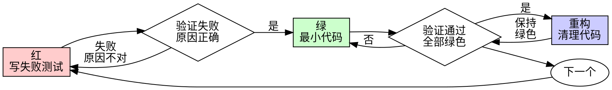

# 测试驱动开发（TDD）

## 概述

先写测试。看它失败。再写最少的代码让它通过。

**核心原则：** 没亲眼见过测试失败，你就无法确认它测的是对的东西。

**违背规则的字面，便是违背规则的精神。**

## 何时使用

**始终使用：**
- 新功能
- Bug 修复
- 重构
- 行为变更

**例外（须征得用户同意）：**
- 一次性原型
- 生成的代码
- 配置文件

脑中冒出"就这一次跳过 TDD"的念头？停。那是自我开脱。

## 铁律

```
没有失败的测试，就不写生产代码
```

先写了代码才想起测试？删掉。从头来过。

**没有例外：**
- 别留作"参考"
- 别在写测试时"改改用"
- 别看它
- 删就是删

从测试出发，重新实现。没有商量。

## 红-绿-重构



### 红 - 写失败测试

写一个最小的测试，描述应该发生什么。

<Good>
```typescript
test('retries failed operations 3 times', async () => {
  let attempts = 0;
  const operation = () => {
    attempts++;
    if (attempts < 3) throw new Error('fail');
    return 'success';
  };

  const result = await retryOperation(operation);

  expect(result).toBe('success');
  expect(attempts).toBe(3);
});
```
命名清晰，测真实行为，只测一件事
</Good>

<Bad>
```typescript
test('retry works', async () => {
  const mock = jest.fn()
    .mockRejectedValueOnce(new Error())
    .mockRejectedValueOnce(new Error())
    .mockResolvedValueOnce('success');
  await retryOperation(mock);
  expect(mock).toHaveBeenCalledTimes(3);
});
```
命名含糊，测的是 mock 而非代码
</Bad>

**要求：**
- 一个行为
- 命名清晰
- 真实代码（除非万不得已，不用 mock）

### 验证红 - 看它失败

**强制。绝不跳过。**

```bash
npm test path/to/test.test.ts
```

确认：
- 测试失败（不是报错）
- 失败信息符合预期
- 因功能缺失而失败（不是拼写错误）

**测试通过了？** 你在测已有行为。去改测试。

**测试报错了？** 修掉错误，重跑，直到它正确地失败。

### 绿 - 最小代码

写最简单的代码让测试通过。

<Good>
```typescript
async function retryOperation<T>(fn: () => Promise<T>): Promise<T> {
  for (let i = 0; i < 3; i++) {
    try {
      return await fn();
    } catch (e) {
      if (i === 2) throw e;
    }
  }
  throw new Error('unreachable');
}
```
刚好够通过
</Good>

<Bad>
```typescript
async function retryOperation<T>(
  fn: () => Promise<T>,
  options?: {
    maxRetries?: number;
    backoff?: 'linear' | 'exponential';
    onRetry?: (attempt: number) => void;
  }
): Promise<T> {
  // YAGNI
}
```
过度设计
</Bad>

不加功能，不重构别的代码，不"顺手改进"测试范围之外的东西。

### 验证绿 - 看它通过

**强制。**

```bash
npm test path/to/test.test.ts
```

确认：
- 当前测试通过
- 其他测试仍然通过
- 输出干净（无错误、无警告）

**测试失败了？** 改代码，不改测试。

**其他测试挂了？** 现在就修。

### 重构 - 清理代码

只在绿色之后：
- 消除重复
- 改善命名
- 提取辅助函数

保持测试绿色。不加新行为。

> 重构属于 review 阶段，不属于红→绿循环本身。循环里只做最小实现；结构性的清理留到 review。

### 循环

为下一个功能写下一个失败测试。

## 好测试

| 品质 | 好 | 坏 |
|------|-----|-----|
| **最小** | 只测一件事。名字里有"和"？拆开。 | `test('validates email and domain and whitespace')` |
| **清晰** | 名字描述行为 | `test('test1')` |
| **展示意图** | 展示期望的 API | 模糊了代码该做什么 |

## Seams — 在哪里测

**Seam（缝隙）** 是你测试的公共边界：在不伸入内部的情况下观察行为的接口。测试只写在 seam 上，永远不对内部实现写测试。

**只在事先确认的 seam 上写测试。** 写任何测试之前，先列出被测的 seams，和用户确认。不在未确认的 seam 上写测试。你不可能测所有东西——事先约定 seam，测试精力才能落在关键路径和复杂逻辑上，而不是每个边界情况。

问："公共接口是什么？我们应该测哪些 seams？"

## 何时 Mock

只在**系统边界** mock：

- 外部 API（支付、邮件等）
- 数据库（有时——优先用测试数据库）
- 时间 / 随机数
- 文件系统（有时）

**不要 mock：**

- 你自己的类 / 模块
- 内部协作者
- 任何你能控制的东西

**让 mock 变容易的设计：**

```typescript
// 好：依赖注入，外部依赖传进来
function processPayment(order, paymentClient) {
  return paymentClient.charge(order.total);
}

// 坏：内部创建依赖，无法替换
function processPayment(order) {
  const client = new StripeClient(process.env.STRIPE_KEY);
  return client.charge(order.total);
}
```

```typescript
// 好：SDK 风格，每个操作一个函数，各自可独立 mock
const api = {
  getUser: (id) => fetch(`/users/${id}`),
  createOrder: (data) => fetch('/orders', { method: 'POST', body: data }),
};

// 坏：通用 fetcher，mock 时需要条件逻辑
const api = {
  fetch: (endpoint, options) => fetch(endpoint, options),
};
```

## 为什么顺序重要

**"我先写完代码，再补测试验证不就行了"**

后写的测试一跑就过。一跑就过，什么都证明不了：
- 可能测的是错的东西
- 可能测的是实现细节，而非行为
- 可能漏掉了你忘了的边界情况
- 你从没见它抓到过 bug

测试先行，迫使你看到它失败，证明它确实在测东西。

**"我手动测过所有边界情况了"**

手动测试是随性的。你以为自己测全了，但：
- 没有记录测了什么
- 代码变了没法重跑
- 压力下容易漏掉情况
- "我试的时候能用" ≠ 全面

自动化测试是系统的。每次都以同样的方式运行。

**"删掉 X 小时的工作太浪费了"**

沉没成本谬误。时间已经花了。你现在的选择只有两个：
- 删掉，用 TDD 重写（再花 X 小时，高置信度）
- 留着，事后补测试（30 分钟，低置信度，大概率有 bug）

真正的"浪费"是留着你无法信任的代码。没有真测试的能跑的代码，就是技术债。

**"TDD 太教条了，务实就该灵活变通"**

TDD 本身就是务实：
- 提交前就抓到 bug（比事后调试快）
- 防止回归（测试立即抓到破坏）
- 记录行为（测试就是代码怎么用的活文档）
- 支撑重构（放心改，测试兜底）

"务实"的捷径 = 在生产环境调试 = 更慢。

**"后写测试也能达到同样目的——重要的是精神，不是仪式"**

不。后写的测试回答"它做了什么"，先写的测试回答"它该做什么"。

后写的测试被你的实现带偏了。你测的是你建的东西，而非需求要的东西。你验证的是你记得的边界，而非你发现的边界。

先写测试，迫使你在动手之前发现边界情况。后写测试，只是验证你记住了所有情况（你没有）。

事后花 30 分钟补测试 ≠ TDD。你得到了覆盖率，失去了测试有效的证明。

## 常见的自我开脱

| 借口 | 现实 |
|------|------|
| "太简单不用测" | 简单代码也会坏。写个测试只要 30 秒。 |
| "先写完再补测试" | 一跑就过的测试什么都证明不了。 |
| "后写测试也能达到同样目的" | 后写 = "它做了什么？" 先写 = "它该做什么？" |
| "我已经手动测过了" | 随性 ≠ 系统。没有记录，没法重跑。 |
| "删掉 X 小时的工作太浪费" | 沉没成本谬误。留着未验证的代码才是技术债。 |
| "留作参考，先写测试" | 你会照着改。那就是后写测试。删就是删。 |
| "需要先探索一下" | 可以。探索完扔掉，从 TDD 开始。 |
| "测试难写 = 设计不清晰" | 听测试的话。难测 = 难用。 |
| "TDD 会拖慢我" | TDD 比调试快。务实 = 测试先行。 |
| "手动测更快" | 手动证明不了边界情况。每次改动你都得重测。 |
| "现有代码没有测试" | 你在改进它。给现有代码加测试。 |

## 红旗信号 - 停下来，从头来过

- 先写了代码再写测试
- 实现之后才补测试
- 测试一跑就过
- 说不清测试为什么失败
- 测试"以后再加"
- 在自我开脱"就这一次"
- "我已经手动测过了"
- "后写测试也能达到同样目的"
- "重要的是精神不是仪式"
- "留作参考"或"改改现有代码"
- "已经花了 X 小时，删了太浪费"
- "TDD 太教条了，我在务实"
- "这次不一样，因为……"

**以上任何一条都意味着：删掉代码。用 TDD 从头来过。**

## 示例：Bug 修复

**Bug：** 空邮箱被接受

**红**
```typescript
test('rejects empty email', async () => {
  const result = await submitForm({ email: '' });
  expect(result.error).toBe('Email required');
});
```

**验证红**
```bash
$ npm test
FAIL: expected 'Email required', got undefined
```

**绿**
```typescript
function submitForm(data: FormData) {
  if (!data.email?.trim()) {
    return { error: 'Email required' };
  }
  // ...
}
```

**验证绿**
```bash
$ npm test
PASS
```

**重构**
如有需要，提取多字段验证。

## 验证清单

标记工作完成之前：

- [ ] 每个新函数/方法都有测试
- [ ] 实现之前亲眼看到每个测试失败
- [ ] 每个测试因预期原因失败（功能缺失，不是拼写错误）
- [ ] 为每个测试写了最少的代码让它通过
- [ ] 所有测试通过
- [ ] 输出干净（无错误、无警告）
- [ ] 测试使用真实代码（除非万不得已才用 mock）
- [ ] 边界情况和错误情况已覆盖

不能全部勾选？你跳过了 TDD。从头来过。

## 卡住时

| 问题 | 解法 |
|------|------|
| 不知道怎么测 | 写你期望的 API。先写断言。问用户。 |
| 测试太复杂 | 设计太复杂。简化接口。 |
| 必须 mock 所有东西 | 代码耦合太紧。用依赖注入。 |
| 测试准备代码巨大 | 提取辅助函数。还是复杂？简化设计。 |

## 调试集成

发现 bug？写一个失败测试复现它。走 TDD 循环。测试证明修复有效，并防止回归。

永远不要不写测试就修 bug。

## 测试反模式

添加 mock 或测试工具时，阅读 [testing-anti-patterns.md](testing-anti-patterns.md) 以避免常见陷阱：
- 测试 mock 行为而非真实行为
- 在生产类中添加测试专用方法
- 不理解依赖就 mock

## 最终规则

```
生产代码 → 测试存在且先失败过
否则 → 不是 TDD
```

没有用户许可，没有例外。
