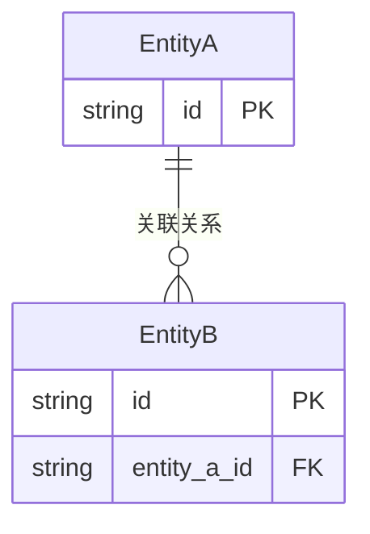

# [MODULE_NAME] 数据模型

> 本文档描述模块的核心数据结构。如模块不涉及持久化存储，可聚焦于运行时数据结构和接口类型定义。

## 1. 文档概述

| 属性 | 内容 |
| :--- | :--- |
| **模块名称** | [MODULE_NAME] |
| **存储方式** | [数据库 / 文件系统 / 内存 / 无持久化] |
| **核心实体** | [列出主要实体名] |

---

## 2. 核心数据结构

### 2.1 [实体/结构名]

**用途**：[一句话描述]

| 字段 | 类型 | 约束 | 说明 |
| :--- | :--- | :--- | :--- |
| [field_1] | [type] | [约束] | [说明] |
| [field_2] | [type] | [约束] | [说明] |

### 2.2 [实体/结构名]

**用途**：[描述]

| 字段 | 类型 | 约束 | 说明 |
| :--- | :--- | :--- | :--- |
| [field_1] | [type] | [约束] | [说明] |

---

## 3. 数据关系

> 如有实体间关系，用 ER 图或文字描述。

---

## 4. 持久化策略（适用时填）

> 模块涉及数据持久化时填写，纯内存或无状态模块跳过。

* **存储引擎**：[数据库 / 文件 / KV Store / ...]
* **数据生命周期**：[永久 / TTL 过期 / 会话级]
* **迁移方案**：[如何处理数据结构变更]

---

## 5. 数据约束与规则

* **验证规则**：[数据层面的约束规则]
* **一致性要求**：[事务、最终一致性等]
