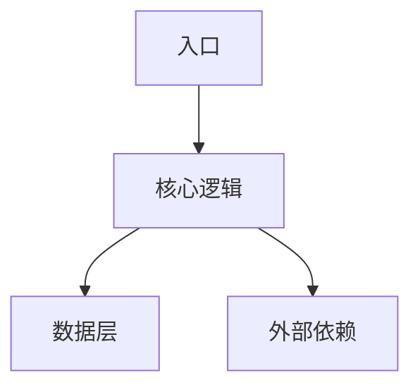
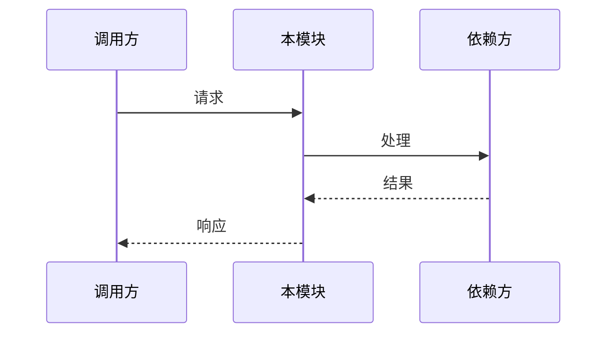
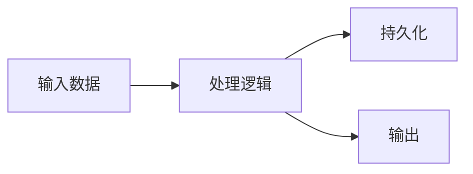

# [MODULE_NAME] 技术设计

## 0. 文档信息

| 属性 | 内容 |
| :--- | :--- |
| **所属变更** | [CHANGE_ID] |
| **模块名称** | [MODULE_NAME] |
| **模块类型** | [MODULE_TYPE] |
| **创建时间** | [CREATED_AT] |

---

## 1. 背景与目标

* **技术背景**：[当前技术现状及要解决的技术问题]
* **技术目标**：[本次技术设计要达成的目标]

---

## 2. 模块职责边界

**负责：**
- [职责 1]
- [职责 2]

**不负责（显式排除）：**
- [排除 1]
- [排除 2]

**调用关系：**

| 方向 | 模块 | 方式 |
| :--- | :--- | :--- |
| 被调用 | [上游模块] | [调用方式] |
| 调用 | [下游模块] | [调用方式] |

---

## 3. 技术选型

| 技术领域 | 选择方案 | 备选方案 | 选择理由 |
| :--- | :--- | :--- | :--- |
| [领域] | [方案] | [备选] | [理由] |

---

## 4. 架构概述

> 根据模块实际情况选择合适的架构图。



### 目录结构

```
src/
├── [根据实际项目结构填写]
```

---

## 5. 关键流程设计

### DS-NNN [核心流程名称]
fr: FR-NNN
depends: DS-NNN, DS-NNN@other-module



---

## 6. 数据流转

### 6.1 数据流



### 6.2 核心数据流转说明

| 数据 | 入口 | 处理环节 | 出口 |
| :--- | :--- | :--- | :--- |
| [数据名] | [来源] | [处理逻辑] | [去向] |

---

## 7. 错误处理策略

| 错误场景 | 处理方式 | 降级方案 |
| :--- | :--- | :--- |
| [错误场景 1] | [处理方式] | [降级方案] |
| [错误场景 2] | [处理方式] | [降级方案] |

---

## 8. 设计决策记录

### 决策 1：[决策标题]

* **问题**：[需要做决策的具体问题]
* **候选方案**：
  * A — [方案描述]：[优点] / [缺点]
  * B — [方案描述]：[优点] / [缺点]
* **决策**：选择方案 [X]
* **理由**：[为什么选择这个方案]
