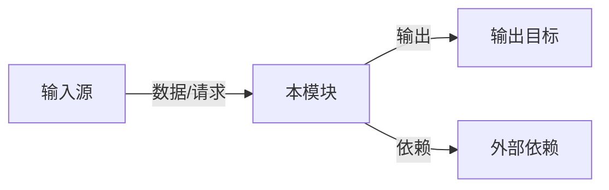
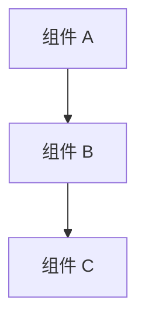

# [MODULE_NAME] 概要设计

## 0. 文档信息

| 属性 | 内容 |
| :--- | :--- |
| **所属变更** | [CHANGE_ID] |
| **模块名称** | [MODULE_NAME] |
| **模块类型** | [MODULE_TYPE] |
| **创建时间** | [CREATED_AT] |

### 修订记录

| 版本号 | 修改日期 | 修改内容摘要 | 修改人 |
| :--- | :--- | :--- | :--- |
| v1.0 | [CREATED_AT] | 初稿创建 | [AUTHOR] |

---

## 1. 技术范围界定

### 1.1 起点与终点

| 维度 | 说明 |
| :--- | :--- |
| **起点** | [本模块的输入来源] |
| **终点** | [本模块的输出目标] |
| **解决的问题** | [一句话说清楚这个模块在技术层面解决什么问题] |

### 1.2 技术边界

- **上游依赖**：[哪些系统/模块向本模块提供输入]
- **下游依赖**：[本模块的输出去向哪里]
- **不涉及**：[明确本模块不处理的部分]

---

## 2. 架构方向探索

| 方向 | 核心思路 | 适合场景 | 风险 |
| :--- | :--- | :--- | :--- |
| [方向 1] | [一句话描述] | [什么情况下选] | [主要风险] |
| [方向 2] | [一句话描述] | [什么情况下选] | [主要风险] |

**选定方向**：[方向 X]
**选择理由**：[为什么选这个方向]

---

## 3. 架构方案

> 根据模块实际情况画出架构图，不限定具体风格。

[用文字补充说明架构图中的关键设计决策]

---

## 4. 技术选型

> 根据模块实际需要列出技术选型，不预设领域。

| 领域 | 选型 | 理由 |
| :--- | :--- | :--- |
| [领域 1] | [技术/工具] | [选择理由] |
| [领域 2] | [技术/工具] | [选择理由] |

### 宪章合规性

- [ ] 符合 `constitution.md` 的技术栈约束
- [ ] 符合安全性要求
- [ ] 符合性能要求

---

## 5. 待研究事项

| 编号 | 待研究问题 | 优先级 | 影响范围 |
| :--- | :--- | :--- | :--- |
| R-01 | [不确定的技术点] | 高 / 中 / 低 | [影响哪些设计决策] |

---

## 6. 风险与对策

| 风险 | 概率 | 影响 | 对策 |
| :--- | :--- | :--- | :--- |
| [风险描述] | 高/中/低 | 高/中/低 | [应对策略] |

---

## 7. 概要设计确认

- [ ] 技术范围已界定
- [ ] 架构方向已探索并选定
- [ ] 架构方案已确认
- [ ] 技术选型符合宪章
- [ ] 待研究事项已识别

👉 确认后进入详细设计阶段（`/xf:detail`）
