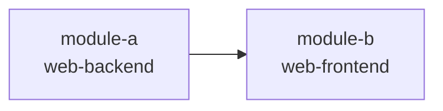

# [CHANGE_NAME] 跨模块协调视图

> 本文件是跨模块集成的导航与协调中心，不是任务汇总表。
> 各模块内部任务在对应 `task.md` 中管理，通过下方索引导航。

## 基本信息

| 属性 | 内容 |
| :--- | :--- |
| **变更编号** | [CHANGE_ID] |
| **变更名称** | [CHANGE_NAME] |
| **生成时间** | [CREATED_AT] |

---

## 1. 模块任务索引

| 模块 | 类型 | 任务文件 | 任务数 |
| :--- | :--- | :--- | :--- |
| [module-a] | web-backend | [`task.md`](./module-a/task.md) | X |
| [module-b] | web-frontend | [`task.md`](./module-b/task.md) | X |

---

## 2. 跨模块执行顺序

<!--
  基于模块间依赖关系生成，展示推荐的启动和实现顺序。
  更细粒度的任务依赖可通过 xf-deps.mjs 脚本查询：
  node .xflow/scripts/xf-deps.mjs --module <name>
-->

---

## 3. 跨模块集成任务

<!--
  仅收录跨越模块边界的集成任务，不包含任何模块内部任务。
  典型场景：前后端联调、API 契约验证、E2E 测试、多模块数据流对齐。
  任务编号从 I001 起，与模块内 T 编号区分。
  依赖标注继续使用 depends: TNNN@module 格式指向具体模块任务。
-->

### 阶段：接口联调

- [ ] I001 P0 [集成任务描述]（涉及模块：module-a ↔ module-b）
  depends: T030@module-a, T020@module-b

### 阶段：端到端验证

- [ ] I002 P0 [E2E 测试描述]
  depends: I001

---

## 4. 质量门禁

- [ ] 所有模块 task.md 任务已完成
- [ ] 跨模块接口联调通过
- [ ] 验收标准全部覆盖（AC-xx）
- [ ] E2E / 集成测试通过
- [ ] 代码审查完成
- [ ] 部署前检查完成
