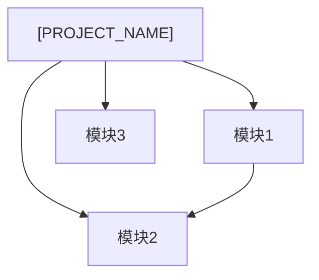

# [PROJECT_NAME] 产品定位

## 产品概述

[一段话描述产品定位、目标市场和核心价值主张]

## 目标用户

| 用户角色 | 描述 | 核心诉求 |
| :--- | :--- | :--- |
| [角色1] | [描述] | [诉求] |
| [角色2] | [描述] | [诉求] |

## 模块结构

### 模块列表

| 模块 | 类型 | 职责描述 | 状态 |
| :--- | :--- | :--- | :--- |
| [模块名] | web-frontend / web-backend | [职责边界一句话描述] | 规划中 / 已实现 |

### 模块依赖关系

| 模块 | 依赖 | 依赖类型 | 说明 |
| :--- | :--- | :--- | :--- |
| [模块A] | [模块B] | 接口调用 / 数据共享 / 事件通知 | [简要说明] |

## 产品边界

### 做什么
- [核心功能1]
- [核心功能2]

### 不做什么
- [明确排除的功能1]
- [明确排除的功能2]

## 版本信息

| 属性 | 内容 |
| :--- | :--- |
| 版本 | 1.0.0 |
| 创建日期 | [DATE] |
| 最后更新 | [DATE] |
