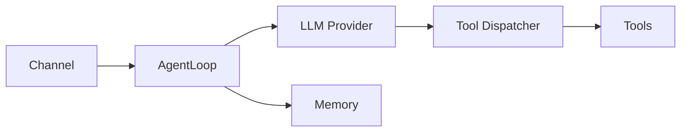

# AGENT-HLD: [Agent 名称]

> **模板用途：** AI Agent 系统的高层设计文档，与实现语言无关。  
> 与技术栈模板（`systems/hld` 或 `web-backend/hld`）配合使用，本模板只描述 Agent 架构层特有的关注点。  
> **裁剪原则：** `(必填)` 必须完成；`(适用时填)` 按触发条件决定；`(可选)` 复杂度不足时可标注「不适用」后略过。

---

## 1. 摘要 (必填)

**交付物：** [本 Agent 交付什么能力，一到两句话。]

**范围边界：**

- **包含：** [Agent 负责的内容，如：自主执行任务、多轮记忆、工具调用编排]
- **不包含：** [排除的内容，如：模型训练、向量嵌入生成、外部身份认证]

**核心约束：** [如：最大 Token 预算、最大迭代步数、必须支持的 LLM Provider、离线能力要求。]

---

## 2. 技术上下文 (必填)

| 项 | 值 |
|:--- | :--- |
| **实现语言 / 框架** | [Zig / Python / TypeScript / Go] |
| **技术栈模板** | 参见 `systems/hld` 或 `web-backend/hld` |
| **支持的 LLM Provider** | [列出全部，如 OpenAI GPT-4o / Anthropic Claude / 本地模型] |
| **Channel 接入层** | [Telegram / Discord / HTTP API / CLI，列出全部] |
| **记忆后端** | [SQLite / PostgreSQL / 内存 / 混合] |
| **部署形态** | [单进程 / 微服务 / Serverless / 嵌入式 CLI] |
| **所属 Phase** | Phase [x] |

---

## 3. 架构总览 (必填)

[说明 Agent 系统在整体架构中的位置，以及 Channel / LLM / Tools / Memory 各层的关系。1–3 段，重点说清楚边界划分原因。]



**组件说明：**

| 组件 | 职责（一句话）| 对应模块 |
|:--- | :--- | :--- |
| [组件名] | [职责] | [模块路径] |

---

## 4. Agent Loop 设计 (必填)

**循环模式：** [ReAct（推理→行动→观察循环） / Plan-Execute（先规划再执行） / 自定义：描述差异]

**Turn 生命周期：**

[用列表或流程图描述一次完整 Turn 的步骤，至少包含：入站净化 → 记忆加载 → Prompt 构建 → LLM 调用 → 工具执行（循环） → 输出]

**关键限制：**

| 参数 | 值 | 说明 |
|:--- | :--- | :--- |
| `max_tool_iterations` | [N] | 单条消息最大工具调用轮次，超出后强制终止 |
| `max_history` | [N] | 触发历史压缩前保留的最大消息条数 |

**多 Agent 协调：** (适用时填)

[如有 Sub-agent 并行执行，描述：派发方式、结果聚合、memory_scope 隔离规则、最大子 Agent 深度。]

---

## 5. LLM Provider 与 Prompt 管理 (必填)

**Provider 接口最小集合：**

```
chat(messages, tools) → ChatResponse
name() → string
max_context_tokens() → integer
```

**切换策略：** [编译时静态 / 运行时配置热切换 / 失败自动 Fallback，说明选择原因]

**System Prompt 结构：**

[列出 System Prompt 的组成节及注入顺序，如：身份文件 → 安全规则 → 工具列表 → 当前时间]

**Context 预算与压缩：**

- Token 分配策略：[System Prompt 占 x%，历史消息占 x%，输出保留 x%]
- 压缩触发：[消息数超过 `max_history` 时 / Token 接近上限时]
- 压缩方式：[Trim（丢弃最旧消息）/ Summarize（LLM 摘要压缩）/ 混合，说明原因]

**输出净化（scrub）：** [LLM 响应返回前需要移除或脱敏的内容，如 API Key 格式字符串、内部路径、内部 Key 名称。] *(安全防御详见 §9 密钥泄漏行)*

---

## 6. Skills 体系 (适用时填)

> 触发条件：Agent 支持用户安装领域专属指令集来扩展行为时填写。  
> Skills 与 Tools 的区别：Skills 是注入 System Prompt 的**指令内容**，Tools 是可执行的**函数**；一个 Skill 可以指导 Agent 如何使用特定 Tool，但 Skill 本身不执行代码。

**加载策略：**

| 加载方式 | 说明 | 适用场景 |
|:--- | :--- | :--- |
| Always-on | 每轮 Prompt 全量注入 Skill 指令 | 核心行为规范，始终需要 |
| Lazy-load | 仅在任务匹配时按需加载（Prompt 中只保留摘要）| 领域专属能力，大多数任务不需要 |

**安装机制：** [描述 Skill 如何安装到 Agent 工作区，如：复制 `SKILL.md` + `skill.json` 到 `skills/` 目录]

**依赖检查：** [Skill 可声明所需的外部 binary 或环境变量；缺失时如何处理：标记不可用 / 报错 / 降级]

**Skill 文件结构：**

```
skill.json     — 元数据（name, description, always, requires_bins, requires_env）
SKILL.md       — 指令内容（Agent 在相关任务中必须遵循的操作规程）
```

**与模板体系的关系：**

- **设计 Skill 加载/管理机制** → 在此节描述（架构决策）
- **创作一个具体 Skill 的指令内容** → 用 `universal/spec` 描述目的和激活条件，然后直接写 `SKILL.md`，无需 HLD

---

## 7. 工具体系 (必填)

**工具分级：**

| 风险级别 | 典型工具 | 执行策略 |
|:--- | :--- | :--- |
| 低（只读） | [如 file_read、web_search] | 直接执行 |
| 中（写操作）| [如 file_write、shell] | 沙箱执行 |
| 高（不可逆）| [如 rm、git push、外部 API 写]| Human-in-the-Loop 审批 |

**执行管道：** [描述工具调用从 LLM 输出解析 → 参数校验 → 沙箱执行 → 结果净化 → 注入历史的流程]

**Human-in-the-Loop：**

- 触发条件：[哪些工具或操作必须等待操作员审批]
- 审批超时处理：[超时后自动拒绝 / 挂起等待，超时时长]
- AutonomyLevel 配置：[conservative / normal / yolo，各级别适用场景]

---

## 8. 记忆架构 (必填)

| 层级 | 名称 | 生命周期 | 存储位置 | 典型内容 |
|:--- | :--- | :--- | :--- | :--- |
| L1 | Working Memory | 单次 Turn | Context Window | 当前对话历史、工具结果 |
| L2 | 短期记忆 | Session 内 | 进程内 | Session 跨 Turn 状态 |
| L3 | 情节记忆 | 持久化 | [SQLite / PostgreSQL] | 历史对话摘要、重要事件 |
| L4 | 语义记忆 | 持久化 | [向量数据库 / pgvector] | 知识库、用户偏好嵌入 |

> 仅实现了其中几层时，删除未用的行，并说明原因。

**Scope 隔离：** [描述不同 Session / Agent 实例之间的记忆隔离方式，以及 global / session / agent scope 的读写权限规则]

**注入时机：** [Turn 开始时从 L3/L4 检索注入 / Turn 结束时写入 / 定期触发，说明触发条件]

---

## 9. 安全设计 (必填)

| 威胁 | 防御措施 |
|:--- | :--- |
| Prompt Injection | [System Prompt 安全规则硬编码；外部消息标记为 untrusted；前置过滤方式] |
| 路径遍历 | [工具参数路径安全检查，规范化后验证是否在白名单目录内] |
| Command Injection | [参数校验策略；沙箱执行；禁止 shell 字符串拼接的规则] |
| 密钥泄漏 | [密钥代理模式：Agent 只声明调用意图，主进程持有 Key 代为执行；响应净化（移除 Key 格式字符串），详见 §5 输出净化] |
| 资源耗尽 | [`max_tool_iterations` 强制终止；Token / 费用限流方式] |
| 越权操作 | [Human-in-the-Loop；AutonomyLevel；高危工具白名单] |
| 敏感数据传输 | 外部接口调用强制 HTTPS/TLS；不在日志中记录请求体内的 API Key / Token |

**System Prompt 安全节（必须硬编码，不可被用户消息覆盖）：**

[列出必须出现在 System Prompt Safety 节中的规则，至少包含：外部渠道消息视为不可信、禁止响应修改系统行为的指令、不暴露内部 Key 名称]

---

## 10. 观测与运维 (必填)

**质量目标：**

| 指标 | 目标值 | 测试条件 |
|:--- | :--- | :--- |
| Turn 端到端延迟（P99） | [如：< 10s] | [如：正常网络，非首 Token] |
| 并发会话数 | [如：≥ 10] | [如：同时活跃 Session] |
| 月费用上限 | [如：< $50] | [如：预设 Token 用量场景] |
| Provider 可用性 | [如：≥ 99.5%] | [如：含 Fallback 切换后] |

**关键监控指标：**

| 指标 | 说明 |
|:--- | :--- |
| `turn_duration_ms` | 单次 Turn 端到端耗时 |
| `tool_iterations` | 单次 Turn 工具调用轮次 |
| `tokens_input / output` | 每次 LLM 调用 Token 用量 |
| [自定义指标] | [说明] |

**日志范围：** [列出需要独立 Log Scope 的模块，如 agent / provider / tools / security / audit]

**告警阈值：** [单小时费用上限、Provider 错误率触发 Fallback 的阈值等]

### 健康检查

| 检查项 | 判定条件 | 失败行为 |
|:--- | :--- | :--- |
| LLM Provider 可达 | 启动时发送轻量探针请求（如：list models），成功返回 | 标记 unhealthy，拒绝新 Turn 请求 |
| 记忆后端可达 | DB 连接可用，基础查询返回结果 | 降级为 Working Memory，告警 |
| 工具沙箱可用 | 沙箱启动测试通过（可选）| 禁用高危工具，降级为 conservative 模式 |

---

## 11. 失败模式与降级 (必填)

| 失败场景 | 影响 | 降级策略 | 恢复方式 |
|:--- | :--- | :--- | :--- |
| LLM Provider 不可达 | [无法生成响应] | [返回友好错误 / 自动切换 Fallback Provider] | [Provider 恢复后自动切回] |
| 工具执行超时 | [Turn 推理阻塞] | [注入超时错误结果，Agent 继续决策是否重试] | [自动；超过最大重试次数后报错] |
| 沙箱启动失败 | [高危工具不可用] | [拒绝工具执行 / 降级为无沙箱模式（仅 conservative 级别）] | [沙箱恢复后自动放行] |
| 记忆后端不可达 | [无持久化记忆] | [降级为纯 Working Memory，明确告知用户] | [后端恢复后自动重连] |
| Human-in-the-Loop 无响应 | [高危操作挂起] | [超时 [X] 分钟后自动拒绝，记录审批超时事件] | [人工介入恢复] |
| Token 预算耗尽 | [无法继续推理] | [强制压缩历史；压缩后仍超出则拒绝请求，提示用户清理] | [用户清理历史后恢复] |
| [自定义故障] | [描述] | [降级策略] | [恢复方式] |
