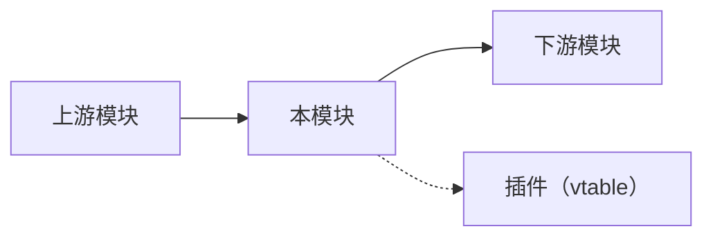

# 系统级高层设计（HLD）

> **模板用途：** Zig / C / Rust 系统级模块的高层设计，适用于有二进制体积 / RSS / 启动时间硬约束的场景。
> 与 `ai-agent/hld` 的区别：本模板关注系统基础设施（可插拔接口、线程模型、内存预算、条件编译）；Agent 推理层关注点（Loop / Prompt / Skills / Memory）参见 `ai-agent/hld`。
> **裁剪原则：** `(必填)` 必须完成；`(适用时填)` 按触发条件决定。

---

## 1. 摘要 (必填)

**交付物：** [本模块交付什么能力，一到两句话。]

**范围边界：**

- **包含：** [模块负责的内容，如：HTTP 基座、TLS 终结、鉴权、入站限速]
- **不包含：** [排除的内容，如：业务逻辑路由、Agent 编排、数据持久化]

**核心约束：** [如：二进制体积贡献 ≤ 200 KB；该模块初始化时间 < 1 ms；峰值 RSS ≤ 512 KB]

---

## 2. 技术上下文 (必填)

| 项 | 值 |
|:--- | :--- |
| **实现语言** | [Zig 0.15.x / C17 / Rust 2021 Edition] |
| **所属 Phase** | Phase [x] |
| **上游依赖模块** | [如：002-bus、001-config] |
| **下游消费模块** | [如：004-channels、016-web-ui] |
| **持久化后端** | [SQLite WAL / 无 / PostgreSQL（可选）] |
| **线程模型** | [thread-per-turn / 单线程 / 独立后台线程] |
| **资源预算** | [体积贡献 / RSS / 初始化耗时，具体数值] |

---

## 3. 架构总览 (必填)

[说明本模块在整体架构中的位置，以及与上下游的关系。1–3 段，重点说清楚边界划分原因。]



**组件说明：**

| 组件 | 职责（一句话） | 对应源文件 |
|:--- | :--- | :--- |
| [组件名] | [职责] | `src/[path].zig` |

---

## 4. 可插拔接口设计 (必填)

> 本节定义本模块暴露的公开接口（vtable / trait / 函数指针表），用于与上下游模块解耦，使实现可替换。

### 4.1 接口结构

> **语言注**：下方为 Zig vtable 示例语法。C 使用函数指针结构体；Rust 使用 `trait` 对象（`dyn Trait`）。

```zig
// Zig 示例
pub const [Module]VTable = struct {
    // 核心操作
    [operation]: *const fn ([context], [input]) [ErrorUnion][ReturnType],

    // 生命周期
    init: *const fn (allocator: Allocator, config: Config) ![Self],
    deinit: *const fn (self: *Self) void,
};
```

### 4.2 注册与发现

| 项 | 说明 |
|:--- | :--- |
| **注册方式** | [编译时 comptime 注册 / 运行时工厂注册 / 混合] |
| **注册时机** | [进程启动时 / 首次使用时懒加载] |
| **工厂函数** | [如：`pub fn create(allocator, config) !*Self`] |

### 4.3 实现约定

- 所有实现**必须**满足接口签名，不得依赖实现特有字段
- 接口指针生命周期 **≥** 宿主模块生命周期
- 实现之间不可互相引用内部字段，只通过接口交互

---

## 5. 线程模型 (必填)

> 根据项目宪法：thread-per-turn（Session Turn 2 MB 栈），不同 session 并行，同一 session 串行。

### 5.1 并发策略

| 项 | 说明 |
|:--- | :--- |
| **线程角色** | [主线程 / Worker 线程 / 后台线程，列出全部] |
| **数据竞争面** | [哪些数据跨线程共享，保护方式：Mutex / Atomic / Channel / 无共享] |
| **锁粒度** | [全局锁 / 组件级锁 / 无锁设计] |
| **死锁预防** | [锁获取顺序规则 / tryLock 超时 / 无嵌套锁] |

### 5.2 线程安全规则

- 规则 1：[如：`init()` / `deinit()` 仅主线程调用，无需加锁]
- 规则 2：[如：`operation()` 可被多 Worker 并发调用，内部状态用 Mutex 保护]
- 规则 3：[如：回调函数不得持锁调用外部 vtable]

---

## 6. 内存预算与分配策略 (必填)

> 根据项目宪法：峰值 RSS ≤ 4 MB（空载基线）。每个模块必须声明自己的内存预算。

### 6.1 预算分配

| 分配项 | 预算 | 说明 |
|:--- | :--- | :--- |
| 静态/全局结构 | [如：8 KB] | [如：vtable + 工厂注册表] |
| 初始化时分配 | [如：64 KB] | [如：配置缓冲区 + 连接池] |
| 运行时峰值 | [如：256 KB / 连接] | [如：每活跃 Session 的请求上下文] |
| **合计贡献** | [如：≤ 512 KB] | [空载基线 + 最大活跃负载] |

### 6.2 分配器选择

| 场景 | 分配器 | 原因 |
|:--- | :--- | :--- |
| 模块生命周期 | `GeneralPurposeAllocator` | 内存泄漏检测（Debug） |
| 请求/Turn 生命周期 | `ArenaAllocator` | 批量释放，零碎片 |
| 热路径小对象 | `FixedBufferPool` | 零分配开销，预分配 |
| 临时计算 | `StackFallbackAllocator` | 栈优先，溢出到堆 |

### 6.3 内存安全不变式

- 所有堆分配**必须**有明确的释放方（`defer` 或 `arena.reset()`）
- 不得返回 Arena 内部指针给 Arena 外部（use-after-arena-reset）
- 跨边界传递的切片：标注所有权语义（caller-owned / borrowed / self-owned）

---

## 7. 条件编译与二进制体积控制 (适用时填)

> 触发条件：模块支持可选编译（按渠道 / 按功能裁剪）时填写。

### 7.1 编译开关

| 编译标志 | 默认值 | 启用时包含 | 贡献体积 |
|:--- | :---: | :--- | :--- |
| `[enable_xxx]` | `false` | [如：Telegram 渠道实现] | [如：+30 KB] |
| `[enable_yyy]` | `true` | [如：SQLite 存储后端] | [如：+80 KB] |

### 7.2 裁剪策略

- 未启用功能的 vtable 注册为空（comptime 判断），运行时无额外开销
- 可选依赖用 `@compileError` 防止误用
- 体积基准测试：`zig build -Doptimize=ReleaseSmall` 后测量

---

## 8. 数据存储层 (适用时填)

> 触发条件：模块需要持久化存储时填写。

### 8.1 存储后端

| 后端 | 适用场景 | 启用条件 |
|:--- | :--- | :--- |
| SQLite (WAL) | 单实例 / 本地 / 嵌入式 | 默认启用 |
| PostgreSQL | 多实例 / 云端 / 共享存储 | 编译标志 + 配置 |

### 8.2 Schema 管理原则

- 迁移脚本使用 `IF NOT EXISTS` / `IF EXISTS`，确保幂等
- 每次迁移只做一件事
- Schema 版本记录在 `_meta` 表中
- 详细 Schema 设计参见 `systems/data-model` 文档

---

## 9. 安全设计 (必填)

| 威胁 | 防御措施 |
|:--- | :--- |
| 内存越界 | Zig 编译时边界检查 + Debug 模式安全检查；Release 模式需显式 `@optimizeFor` |
| 整数溢出 | 默认检测溢出；热路径显式 `@wrappingOps` 需 Code Review 审批 |
| 路径遍历 | 工具参数路径规范化后验证白名单目录 |
| 资源耗尽 | 请求级 Arena 限制 + 全局 RSS 预算硬截断 |
| 配置注入 | yolo 模式启动时检测拒绝；autonomy level 不可通过工具调用修改 |
| 密钥泄漏 | 密钥代理模式：模块只声明调用意图，主进程持有 Key 代为执行；响应净化 |
| 敏感数据传输 | 对外 HTTP/IPC 接口强制 TLS（适用时）；不在结构化日志中输出密钥值或敏感字段 |

**安全不变式：**

- [不变式 1，如：所有跨 vtable 边界的数据必须校验，不可信任调用方]
- [不变式 2，如：沙箱执行 + 人机审批，不可静默放行高危操作]

---

## 10. 观测与运维 (必填)

### 质量目标

| 指标 | 目标值 | 测试条件 |
|:--- | :--- | :--- |
| 初始化时间 | < [X] ms | 冷启动 |
| 峰值 RSS 贡献 | ≤ [X] KB | 最大负载 |
| 操作延迟 P99 | < [X] ms | [测试条件] |

### 日志与追踪

| 维度 | 方案 |
|:--- | :--- |
| 日志格式 | [结构化日志，含 module / level / timestamp / trace_id] |
| 日志范围 | [如：gateway / security / audit] |
| 追踪方式 | [trace_id 透传 / OpenTelemetry / 无] |

### 健康检查

| 检查项 | 判定条件 | 失败行为 |
|:--- | :--- | :--- |
| [如：DB 连接] | [如：PRAGMA integrity_check 返回 ok] | [如：标记 unhealthy，拒绝新请求] |

---

## 11. 失败模式与降级 (必填)

| 失败场景 | 影响 | 降级策略 | 恢复方式 |
|:--- | :--- | :--- | :--- |
| 分配器 OOM | [当前请求失败] | [拒绝当前请求，返回错误，不 Panic] | [请求结束后 Arena 自动回收] |
| 下游模块不可达 | [依赖功能不可用] | [返回结构化错误，不阻塞其他模块] | [下游恢复后自动重连] |
| 持久化写入失败 | [数据无法持久化] | [拒绝当前操作，返回错误] | [DB 恢复后重试] |
| 沙箱启动失败 | [高危操作不可用] | [拒绝工具执行，返回审批失败] | [沙箱恢复后自动放行] |
| 配置损坏 | [进程无法启动] | [拒绝启动，FATAL 日志 + exit 1] | [修复配置后重启] |
| [自定义故障] | [描述] | [降级策略] | [恢复方式] |

---

## 12. 测试策略 (必填)

### 12.1 测试层次

| 层次 | 工具/方法 | 通过条件 |
|:--- | :--- | :--- |
| 单元测试 | [`zig build test` / `cargo test` / `ctest`] + 内存检测工具 | 0 memory leak |
| 接口契约测试 | Mock 实现 + 全签名覆盖 | 所有接口方法调用路径验证 |
| 集成测试 | 测试存储后端 / 上下游集成 | 端到端功能正确，并发安全 |
| 压力测试 | ReleaseSmall / Release 构建 | 体积 / RSS / 延迟在预算内 |

### 12.2 跨平台一致性

- 所有测试须在 macOS / Linux 上一致通过
- 不得依赖平台特有行为（如文件系统大小写）
