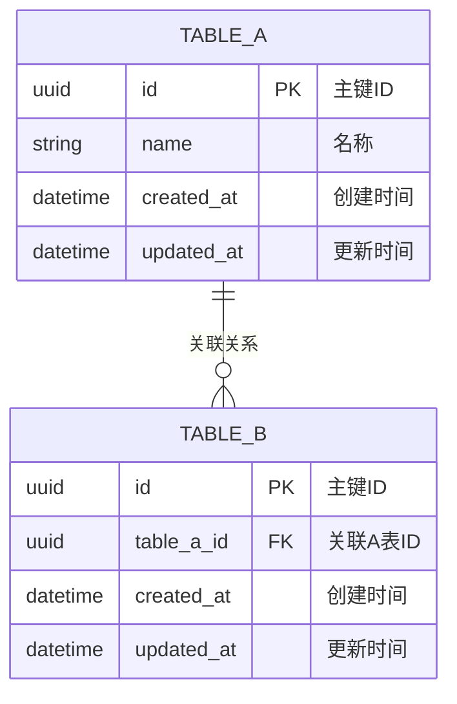

# [MODULE_NAME] Web 后端数据模型

## 1. 文档概述

本文档描述 [MODULE_NAME] 模块的数据库模型设计，包括实体结构、关系、索引策略、事务边界和迁移方案。

| 属性 | 内容 |
| :--- | :--- |
| **数据库类型** | [PostgreSQL / MySQL / MongoDB / ...] |
| **ORM 框架** | [Prisma / TypeORM / SQLAlchemy / GORM / ...] |
| **迁移工具** | [Prisma Migrate / Alembic / Flyway / ...] |
| **核心实体** | [列出主要实体名] |

---

## 2. 实体关系总览

> 用文字描述实体间的关系；详细字段见 §3。

| 关系 | 类型 | 说明 |
| :--- | :---: | :--- |
| [实体 A] → [实体 B] | 1:N | [如：一个 User 有多个 Order] |
| [实体 A] ↔ [实体 C] | M:N | [如：通过 OrderItem 关联] |

### ER 图

---

## 3. 实体定义

> 字段类型使用逻辑类型（`string`、`integer`、`boolean`、`datetime`、`uuid`、`decimal`），不绑定具体方言。

### 3.1 [实体名，如：User]

**用途**：[一句话描述]

| 字段 | 逻辑类型 | 约束 | 说明 |
| :--- | :--- | :--- | :--- |
| `id` | `uuid` | PK，非空 | 主键，系统生成 |
| `[field_1]` | `string(100)` | 非空，唯一 | [说明] |
| `[field_2]` | `string` | 可空 | [说明] |
| `[status]` | `enum` | 非空，默认 `active` | 枚举值按业务定义 |
| `created_at` | `datetime` | 非空，自动填充 | UTC |
| `updated_at` | `datetime` | 非空，自动更新 | UTC |

**软删除策略（三选一）：**

| 策略 | 需要的字段 | 查询过滤条件 |
| :--- | :--- | :--- |
| `deleted_at` 时间戳 | `deleted_at datetime 可空` | `WHERE deleted_at IS NULL` |
| `status = deleted` | status 枚举加 `deleted` 值 | `WHERE status != 'deleted'` |
| 物理删除 | 无需额外字段 | 无需过滤 |

---

### 3.2 [实体名，如：Order]

**用途**：[描述]

| 字段 | 逻辑类型 | 约束 | 说明 |
| :--- | :--- | :--- | :--- |
| `id` | `uuid` | PK，非空 | |
| `user_id` | `uuid` | FK → User.id，非空 | 所属用户 |
| `[field_1]` | `[类型]` | [约束] | [说明] |
| `status` | `enum` | 非空 | 枚举值：[pending / paid / cancelled] |
| `created_at` | `datetime` | 非空，自动填充 | |
| `updated_at` | `datetime` | 非空，自动更新 | |

---

## 4. 关系定义

### 4.1 外键约束

| 外键字段 | 引用表.字段 | ON DELETE | ON UPDATE | 说明 |
| :--- | :--- | :---: | :---: | :--- |
| `[table_b].user_id` | `User.id` | RESTRICT | CASCADE | [删除 User 前必须先删除其关联记录] |
| `[table_c].order_id` | `Order.id` | CASCADE | CASCADE | [删除 Order 时级联删除] |

### 4.2 关联表（M:N 时填）

**表名**：`[entity_a]_[entity_b]`

| 字段 | 类型 | 约束 | 说明 |
| :--- | :--- | :--- | :--- |
| `[entity_a_id]` | `uuid` | FK，PK 组合键 | ON DELETE CASCADE |
| `[entity_b_id]` | `uuid` | FK，PK 组合键 | ON DELETE CASCADE |
| `created_at` | `datetime` | 非空 | |

---

## 5. 索引设计

| 索引名 | 所在实体 | 覆盖字段 | 访问模式 | 取舍说明 |
| :--- | :--- | :--- | :--- | :--- |
| `idx_[table]_[field]` | [实体] | `user_id` | 按 user_id 查询（高频） | 写入开销低，必建 |
| `idx_[table]_[fields]` | [实体] | `status, created_at` | 按状态+时间范围查询 | 复合索引，最左前缀 |
| `uniq_[table]_[field]` | [实体] | `[field]` | 唯一性约束 | 配合软删除策略 |

**索引维护注意：**
- 唯一索引 + 软删除：`deleted_at` 方案用部分索引 `WHERE deleted_at IS NULL`；`status` 方案用条件索引 `WHERE status != 'deleted'`
- 复合索引字段顺序遵循最左前缀原则

---

## 6. 事务边界

| 操作场景 | 涉及实体 | 事务 | 隔离级别 | 说明 |
| :--- | :--- | :---: | :--- | :--- |
| [如：创建订单] | Order + OrderItem | 是 | Read Committed | [必须同时成功或同时回滚] |
| [如：状态变更] | Order | 是 | Repeatable Read | [防止并发状态覆盖] |
| [如：查询] | [实体] | 否 | — | [只读] |

**锁策略（适用时填）：**

| 场景 | 策略 | 实现方式 |
| :--- | :--- | :--- |
| [并发更新] | 乐观锁 | `version` 字段；UPDATE 时 `WHERE version = ?`，0 行受影响返回 409 |
| [强一致性] | 悲观锁 | `SELECT FOR UPDATE`；注意锁粒度和超时 |

---

## 7. 迁移策略

### 7.1 迁移规则

- 所有结构变更通过迁移脚本完成，禁止手动修改生产库 Schema
- 每次迁移只做一件事（加列 / 加索引 / 建表单独成脚本）

### 7.2 安全操作表

| 操作 | 安全做法 | 禁止做法 |
| :--- | :--- | :--- |
| 新增字段 | `ADD COLUMN`，设置默认值或可为 null | 直接加非空无默认值列（会锁表） |
| 删除字段 | 先废弃（应用层停止使用）→ 再删除列 | 直接删除仍在使用的列 |
| 修改字段类型 | 新建列 → 迁移数据 → 切换引用 → 删除旧列 | 直接 ALTER COLUMN TYPE |
| 新增唯一索引 | 先检查数据无重复 → 再建索引 | 直接建索引（有重复时失败） |
| 大表加索引 | `CREATE INDEX CONCURRENTLY`（PG）/ 在线 DDL | 普通 CREATE INDEX（长时间锁表） |

### 7.3 版本追踪

| 字段 | 内容 |
| :--- | :--- |
| 版本命名规范 | [如：`V{timestamp}__{description}.sql`] |
| 回滚策略 | [是否提供 Down Migration；不可逆操作如何处理] |

---

## 8. 数据约束与规则

* **审计字段**：[创建人、创建时间、更新人、更新时间]
* **数据校验**：[数据库级别的约束规则]
