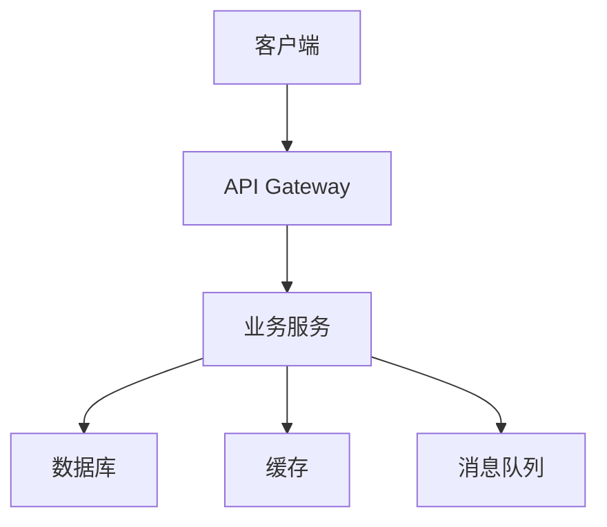
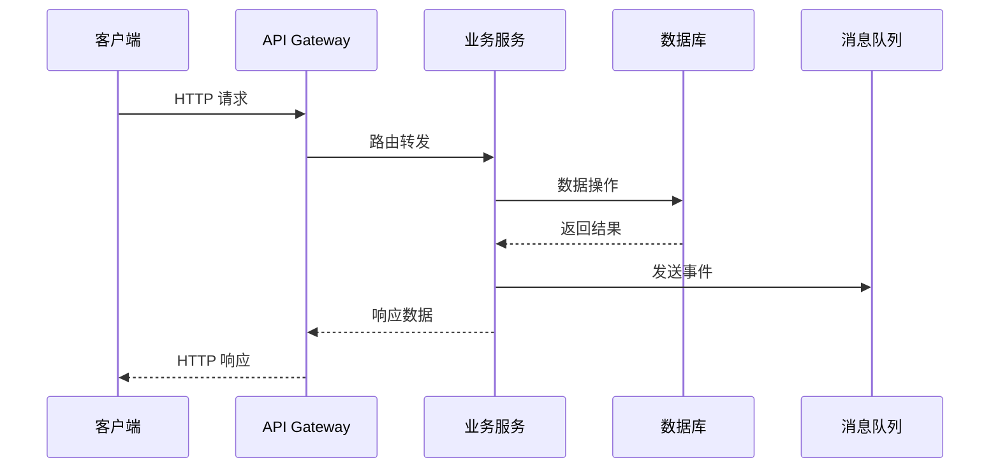
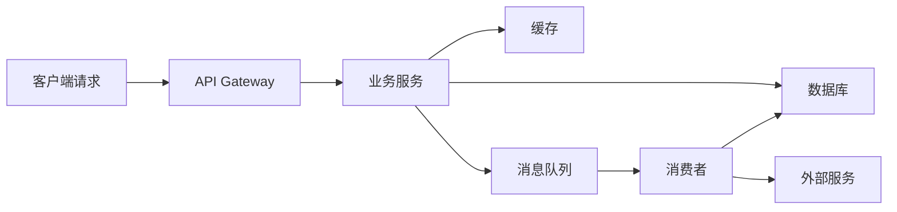
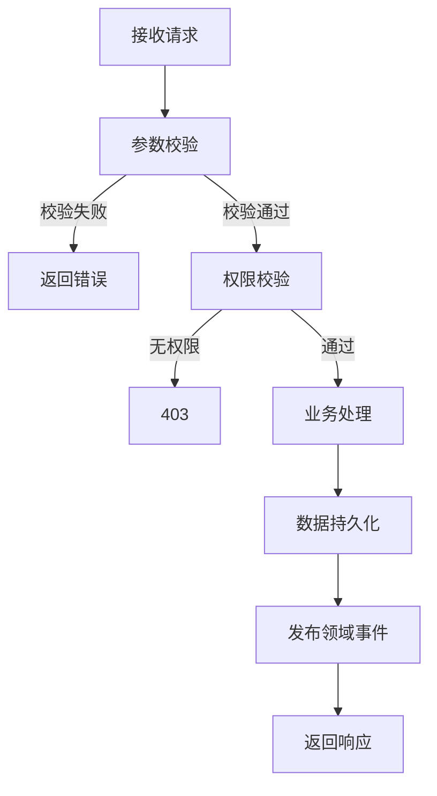

# [MODULE_NAME] Web 后端技术设计

## 0. 文档信息

| 属性 | 内容 |
| :--- | :--- |
| **所属变更** | [CHANGE_ID] |
| **模块名称** | [MODULE_NAME] |
| **模块类型** | web-backend |
| **创建时间** | [CREATED_AT] |

---

## 1. 背景与目标

* **技术背景**：[当前技术现状及要解决的技术问题]
* **技术目标**：[本次技术设计要达成的目标]

---

## 2. 模块职责边界

**负责：**
- [如：用户注册/登录/鉴权的完整业务逻辑]
- [如：用户数据的 CRUD 操作]

**不负责（显式排除）：**
- [如：服务整体架构、中间件链（→ hld）]
- [如：数据库 Schema 和迁移（→ data-model）]

**调用关系：**

| 方向 | 模块 | 方式 |
| :--- | :--- | :--- |
| 被调用 | [如：路由层 / 网关] | HTTP 请求分发 |
| 调用 | [如：通知模块] | [如：创建时同步通知] |

---

## 3. 技术选型与研究

### 2.1 关键技术问题

| 问题 | 选择方案 | 备选方案 | 选择理由 |
| :--- | :--- | :--- | :--- |
| [问题] | [方案] | [备选] | [理由] |

### 2.2 技术研究总结

[对关键技术问题的研究结论]

---

## 4. 架构概述

### 3.1 系统架构



### 3.2 目录结构

```
src/
├── controllers/    # 请求处理层
├── services/       # 业务逻辑层
├── models/         # 数据模型层
├── middleware/      # 中间件
├── routes/         # 路由定义
├── utils/          # 工具函数
└── config/         # 配置文件
```

---

## 5. 关键流程设计

### DS-NNN [核心流程名称]
fr: FR-NNN
depends: DS-NNN, DS-NNN@other-module



---

## 6. 数据流转

### 5.1 系统数据流



### 5.2 核心数据流转说明

| 数据 | 入口 | 处理环节 | 出口 | 持久化 |
| :--- | :--- | :--- | :--- | :--- |
| [数据名] | [API / MQ] | [校验 → 转换 → 业务逻辑] | [响应 / 事件] | [DB 表名] |

### 5.3 关键业务流程



---

## 7. 分层职责落实

### 7.1 Controller 层

> Controller 只做：请求解析、参数校验、调用 Service、响应序列化。不含业务逻辑。

**输入校验（格式校验，失败直接返回，不经异常链）：**

| 字段 / 参数 | 校验规则 | 失败时 |
| :--- | :--- | :--- |
| `[field_1]` | [如：非空，长度 1–100] | 400 |
| `[field_2]` | [如：枚举值 A / B / C] | 400 |

### 7.2 Service 层

> 包含全部业务逻辑和事务编排，不处理 HTTP 细节。

**公开方法：**

| 方法签名 | 职责 | 事务 | 抛出异常 |
| :--- | :--- | :---: | :--- |
| `create(input) → Entity` | [说明] | 是 | [DomainError] |
| `findById(id) → Entity` | [说明] | 否 | NotFoundError |

**业务规则：**
- [规则 1，如：同一用户不能重复创建同名资源]
- [规则 2，如：状态为 LOCKED 的资源不允许修改]

**跨模块调用（适用时填）：**

| 依赖模块 | 调用时机 | 失败处理 |
| :--- | :--- | :--- |
| [模块名] | [如：创建时同步通知] | [忽略 / 回滚 / 异步重试] |

### 7.3 Repository 层

> 封装全部数据库操作，向 Service 屏蔽 ORM 细节。

| 方法签名 | 操作 | 说明 |
| :--- | :--- | :--- |
| `create(Entity) → Entity` | INSERT | [主键冲突抛 ConflictError] |
| `findById(id) → Entity \| null` | SELECT | [不存在返回 null] |
| `findBy(条件, 分页) → { items, total }` | SELECT | [支持的筛选字段] |
| `update(id, 部分字段) → Entity` | UPDATE | [不存在返回 null] |
| `delete(id) → void` | DELETE | [说明] |

### 7.4 DTO 与领域对象映射

| 类型 | 用途 | 转换时机 |
| :--- | :--- | :--- |
| CreateRequestDTO | 接收 POST 请求体 | Controller 入口 |
| UpdateRequestDTO | 接收 PUT/PATCH 请求体 | Controller 入口 |
| Entity | 数据库持久化对象 | Repository ↔ Service |
| ResponseDTO | 序列化响应体 | Controller 出口 |

> **安全规则**：以下字段禁止序列化到 ResponseDTO：`[password_hash]`、`[internal_id]`、`[...]`

---

## 8. 异常处理链

### 8.1 异常类型

> 使用项目/框架实际的异常体系命名，以下为结构示例。

| 异常类 | 抛出层 | 语义 |
| :--- | :--- | :--- |
| [资源不存在异常] | Repository / Service | 资源不存在 |
| [业务校验异常] | Service | 业务规则校验失败 |
| [状态冲突异常] | Service | 资源状态冲突 |
| [未预期异常] | 任意层 | 未预期的系统错误 |

### 8.2 HTTP 状态码映射

| 异常类 | HTTP 状态 | 错误码 | 备注 |
| :--- | :---: | :--- | :--- |
| [资源不存在异常] | 404 | [按 contracts 定义] | — |
| [业务校验异常] | 400 | [按 contracts 定义] | 按具体规则选码 |
| [状态冲突异常] | 409 | [按 contracts 定义] | — |
| [未预期异常] | 500 | [按 contracts 定义] | 不暴露内部细节 |

---

## 9. 数据库设计要点

* **分库分表策略**：[是否需要，策略是什么]
* **索引设计原则**：[关键查询的索引规划]
* **迁移方案**：[数据库变更的迁移计划]

---

## 10. 接口设计要点

* **版本控制**：[API 版本策略]
* **认证鉴权**：[JWT / Session / OAuth2 等]
* **限流策略**：[频率限制规则]

---

## 11. 错误处理与容灾

| 故障场景 | 检测方式 | 处理策略 | 恢复方案 |
| :--- | :--- | :--- | :--- |
| 数据库不可用 | 健康检查 | 返回降级响应 | 自动重连 |
| 外部服务超时 | 超时阈值 | 熔断+缓存 | 重试队列 |

---

## 12. 性能设计

* **QPS 目标**：[预估的请求量]
* **响应时间**：[TP99 目标]
* **缓存策略**：[缓存的层级和失效策略]
* **异步处理**：[需要异步化的操作]

---

## 13. 测试矩阵

| 测试目标 | 测试类型 | 通过条件 |
| :--- | :--- | :--- |
| Controller 输入校验 | 单元测试 | 非法输入返回 400 + 对应错误码 |
| Service 业务规则 | 单元测试（Mock Repository） | 每条规则有正向 + 反向用例 |
| Repository 查询 | 集成测试（测试库） | CRUD 结果与预期一致 |
| 异常映射 | 单元测试 | 每种异常类正确映射到 HTTP 状态码 |
| DTO 字段安全 | 单元测试 | 敏感字段不出现在响应序列化结果中 |

---

## 14. 设计决策记录

<!--
  记录详细设计阶段方案探索环节做出的关键决策。
  每个决策应包含：问题、候选方案、最终选择和理由。
-->

### 决策 1：[决策标题]

* **问题**：[需要做决策的具体问题]
* **候选方案**：
  * A — [方案描述]：[优点] / [缺点]
  * B — [方案描述]：[优点] / [缺点]
* **决策**：选择方案 [X]
* **理由**：[为什么选择这个方案]
