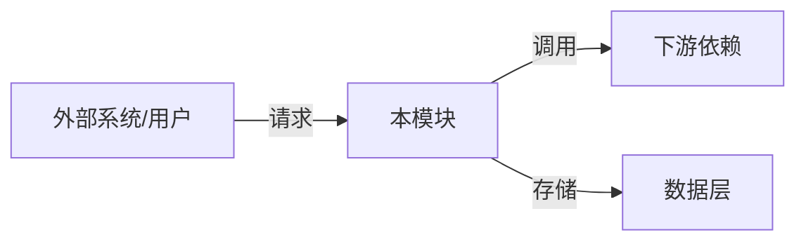
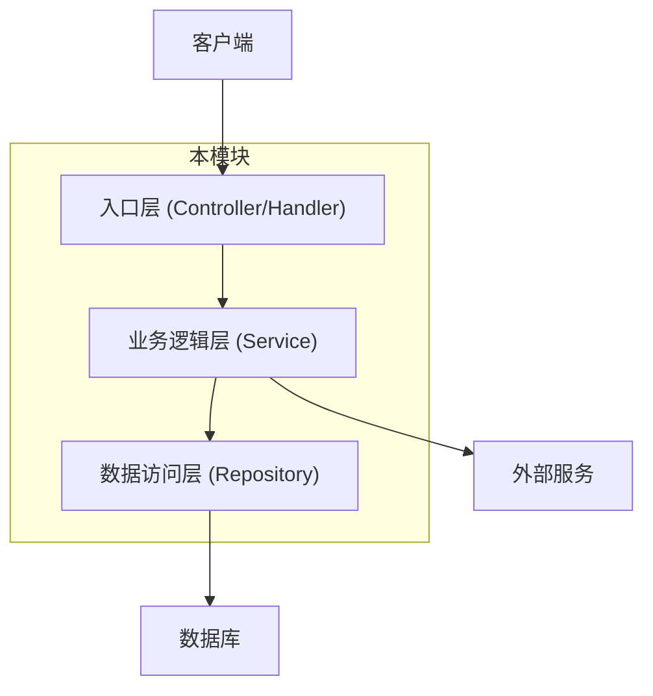
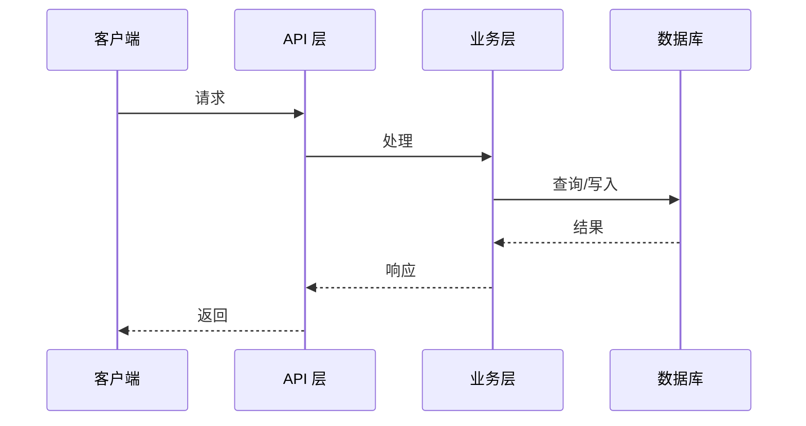

# [MODULE_NAME] Web 后端概要设计

## 0. 文档信息

| 属性 | 内容 |
| :--- | :--- |
| **所属变更** | [CHANGE_ID] |
| **模块名称** | [MODULE_NAME] |
| **模块类型** | web-backend |
| **创建时间** | [CREATED_AT] |

### 修订记录

| 版本号 | 修改日期 | 修改内容摘要 | 修改人 |
| :--- | :--- | :--- | :--- |
| v1.0 | [CREATED_AT] | 初稿创建 | [AUTHOR] |

---

## 1. 技术范围界定

### 1.1 起点与终点

| 维度 | 说明 |
| :--- | :--- |
| **起点** | [本模块的输入来源，例如：API 请求、消息队列事件、定时任务触发] |
| **终点** | [本模块的输出目标，例如：HTTP 响应、数据库持久化、下游服务通知] |
| **解决的问题** | [一句话说清楚这个模块在技术层面解决什么问题] |

### 1.2 技术边界

- **上游依赖**：[哪些系统/模块向本模块发送请求或数据]
- **下游依赖**：[本模块调用哪些外部服务或内部模块]
- **不涉及**：[明确本模块不处理的部分]

---

## 2. 架构方向探索

<!-- 记录概要设计前的架构方向快速探索结果 -->

| 方向 | 核心思路 | 适合场景 | 风险 |
| :--- | :--- | :--- | :--- |
| [方向1] | [一句话描述，例如：单体分层架构] | [什么情况下选] | [主要风险] |
| [方向2] | [一句话描述，例如：微服务拆分] | [什么情况下选] | [主要风险] |

**选定方向**：[方向X]
**选择理由**：[为什么选这个方向，一句话]

---

## 3. 架构方案

### 3.1 整体架构

### 3.2 核心流程

---

## 4. 技术选型与约束

| 领域 | 选型 | 理由 |
| :--- | :--- | :--- |
| 运行时 | [Node.js / Java / Go / ...] | [选择理由] |
| 框架 | [Express / NestJS / Spring / ...] | [选择理由] |
| 数据库 | [PostgreSQL / MySQL / MongoDB / ...] | [选择理由] |
| 缓存 | [Redis / 内存 / 无] | [选择理由] |
| 消息队列 | [RabbitMQ / Kafka / 无] | [是否需要异步处理] |

### 宪章合规性

- [ ] 符合 `constitution.md` 的技术栈约束
- [ ] 符合安全性要求
- [ ] 符合性能要求

---

## 5. 中间件链

> 按执行顺序排列，靠前的先执行。

| 顺序 | 中间件 | 职责 | 失败时 |
| :---: | :--- | :--- | :--- |
| 1 | 请求 ID 注入 | 为每个请求生成唯一 ID，写入响应头 | — |
| 2 | 认证 | 验证 Token / Session，注入用户上下文 | 401 Unauthorized |
| 3 | 授权 | 检查权限 / 角色 | 403 Forbidden |
| 4 | 限流 | 按 IP / User 限制请求速率 | 429 Too Many Requests |
| 5 | 结构化日志 | 记录请求路径、耗时、状态码 | — |
| 6 | 错误处理 | 捕获未处理异常，统一错误响应格式 | 5xx |

---

## 6. 认证与授权

### 6.1 认证方案

| 字段 | 内容 |
| :--- | :--- |
| 方案 | [JWT / Session Cookie / API Key / OAuth2] |
| Token 存储（客户端） | [Authorization Header / HttpOnly Cookie] |
| Token 有效期 | [Access: X min；Refresh: X days] |
| 刷新策略 | [静默刷新 / Refresh Token 轮换 / 无状态] |
| 密钥管理 | [环境变量 / Secret Manager / KMS] |

### 6.2 授权模型

| 字段 | 内容 |
| :--- | :--- |
| 模型 | [RBAC / ABAC / 简单白名单] |
| 角色定义 | [admin / user / guest / ...] |
| 权限粒度 | [路由级 / 资源级 / 字段级] |
| 鉴权时机 | [中间件统一处理 / Service 层按需判断] |

---

## 7. 数据存储与外部依赖

### 7.1 主数据库

| 字段 | 内容 |
| :--- | :--- |
| 数据库 | [PostgreSQL / MySQL / MongoDB / ...] |
| 连接池 | [最大连接数：N；超时：X ms] |
| 读写分离 | [有 / 无] |
| 事务隔离级别 | [Read Committed / Repeatable Read / ...] |

### 7.2 缓存策略（适用时填）

| 字段 | 内容 |
| :--- | :--- |
| 缓存引擎 | [Redis / Memcached / 无] |
| 缓存模式 | [Cache-Aside / Read-Through / Write-Through] |
| TTL 策略 | [按数据类型列出 TTL] |
| 缓存击穿防护 | [互斥锁 / 热点预加载 / 无] |

### 7.3 外部服务依赖

| 服务 | 用途 | 超时配置 | 降级策略 |
| :--- | :--- | :---: | :--- |
| [服务名] | [描述] | [X] ms | [返回默认值 / 熔断] |

---

## 8. 安全设计

| 威胁 | 防御措施 |
| :--- | :--- |
| SQL 注入 | [ORM 参数化查询；禁止拼接 SQL] |
| XSS | [输出转义；Content-Security-Policy 头] |
| CSRF | [SameSite Cookie / CSRF Token] |
| 路径遍历 | [文件路径白名单校验；拒绝 `../` 序列] |
| 密钥泄漏 | [密钥不入代码库；使用 Secret Manager] |
| 敏感数据 | [传输 TLS 1.2+；存储加密 PII；日志脱敏] |

---

## 9. 观测与运维

### 9.1 质量目标

| 指标 | 目标值 | 测试条件 |
| :--- | :---: | :--- |
| P95 响应时间 | ≤ [X] ms | [正常负载 QPS] |
| 可用性 | ≥ [X]% | [滚动 30 天] |
| 错误率（5xx） | ≤ [X]% | [正常流量] |

### 9.2 日志与追踪

| 维度 | 方案 |
| :--- | :--- |
| 日志格式 | [JSON / logfmt]，必含：`request_id`、`level`、`timestamp`、`path`、`status`、`duration_ms` |
| 日志聚合 | [ELK / CloudWatch / Datadog / Loki / ...] |
| 分布式追踪 | [OpenTelemetry + Jaeger / Zipkin / 无] |
| 日志脱敏规则 | [密码、Token、PII 字段写入前屏蔽] |

### 9.3 健康检查端点

| 端点 | 用途 | 检查内容 |
| :--- | :--- | :--- |
| `GET /health` | 存活探针 | 进程在线，返回 200 |
| `GET /ready` | 就绪探针 | DB 连接可用、缓存可用 |

### 9.4 监控告警

| 指标 | 告警阈值 | 通知方式 |
| :--- | :--- | :--- |
| 响应时间 P99 | > [X] ms | [PagerDuty / Slack / 钉钉] |
| 错误率 | > [X]% | [同上] |
| DB 连接池利用率 | > [X]% | [同上] |

---

## 10. 失败模式与降级策略

| 失败场景 | 影响 | 降级策略 | 恢复方式 |
| :--- | :--- | :--- | :--- |
| 数据库不可用 | [描述] | [返回缓存 / 只读模式 / 503] | [自动重连] |
| 缓存不可用 | [描述] | [直接读库；限流保护] | [自动重连] |
| 外部服务超时 | [描述] | [返回默认值 / 熔断] | [Circuit Breaker 自动恢复] |
| 部署滚动更新 | [描述] | [蓝绿 / 金丝雀] | [回滚] |

---

## 11. 待研究事项

<!-- 列出需要在详细设计前调研的技术不确定项，将由 research.md 跟踪 -->

| 编号 | 待研究问题 | 优先级 | 影响范围 |
| :--- | :--- | :--- | :--- |
| R-01 | [不确定的技术点] | 高 / 中 / 低 | [影响哪些设计决策] |
| R-02 | [不确定的技术点] | 高 / 中 / 低 | [影响哪些设计决策] |

---

## 12. 风险与对策

| 风险 | 概率 | 影响 | 对策 |
| :--- | :--- | :--- | :--- |
| [风险描述] | 高/中/低 | 高/中/低 | [应对策略] |

---

## 13. 概要设计确认

- [ ] 技术范围已界定
- [ ] 架构方向已探索并选定
- [ ] 架构方案已确认
- [ ] 技术选型符合宪章
- [ ] 待研究事项已识别

👉 确认后进入详细设计阶段（`/xf:detail`）
