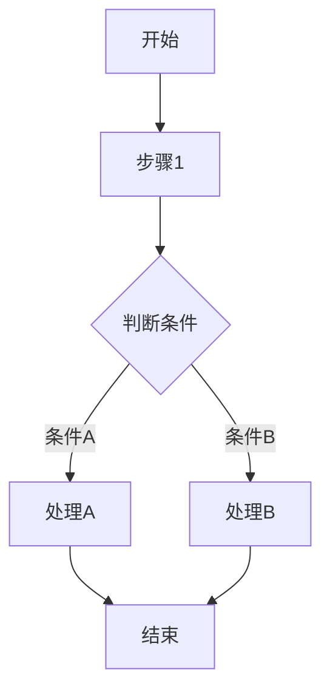
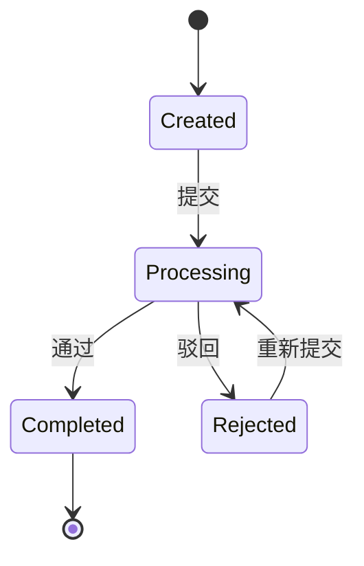

# [MODULE_NAME] Web 后端需求规范

## 0. 文档信息

| 属性 | 内容 |
| :--- | :--- |
| **所属变更** | [CHANGE_ID] |
| **模块名称** | [MODULE_NAME] |
| **模块类型** | web-backend |
| **创建时间** | [CREATED_AT] |

### 修订记录

| 版本号 | 修改日期 | 修改内容摘要 | 修改人 |
| :--- | :--- | :--- | :--- |
| v1.0 | [CREATED_AT] | 初稿创建 | [AUTHOR] |

---

## 1. 业务背景与系统目标

* **业务背景**：[描述当前业务痛点]
* **核心目标**：[本次系统建设/迭代要解决的问题]
<!--
  衡量指标必须满足：
  1. 可衡量：包含具体数值（时间、百分比、数量）
  2. 技术无关：不提及具体中间件、数据库、缓存等
  3. 业务可感知：从业务/用户视角描述，非系统内部指标

  好的: "订单处理在 5 秒内完成" "系统可用性 99.9%"
  坏的: "MySQL QPS > 5000" "Redis 命中率 > 80%"
-->
* **关键衡量指标**：[效率指标、系统可用性等]

---

## 2. 关键概念

> 统一术语定义，后续所有章节直接引用此处概念名，避免歧义。

- **[概念 1]**：[定义，如：订单（Order）= 用户一次完整购买行为的记录]
- **[概念 2]**：[定义及与其他概念的关系]
- **[概念 3]**：[定义]

---

## 3. 超出范围

> 明确本次不做的内容，防止范围蔓延。

- [排除项 1，如：不包含支付对接，假设支付由独立模块处理]
- [排除项 2]
- [排除项 3]

---

## 4. 角色与权限控制（RBAC）

| 角色名称 | 角色描述 | 菜单权限 | 操作权限 | 数据范围 |
| :--- | :--- | :--- | :--- | :--- |
| [角色] | [描述] | [菜单] | [操作] | [范围] |

---

## 5. 业务流程与状态机

### 3.1 跨角色业务流程

### 3.2 核心对象状态机

| 当前状态 | 触发动作 | 目标状态 | 前置条件 |
| :--- | :--- | :--- | :--- |
| [状态] | [动作] | [状态] | [条件] |

---

## 6. 详细功能需求

<!--
  功能描述规则：
  - 只写 WHAT（做什么）和 WHY（为什么），不写 HOW（怎么实现）
  - 禁止出现框架名、库名、ORM 名等技术实现细节（接口概要中的路径除外）
  - 每个功能点必须可追溯到至少一个用户故事或业务场景
  - 异常与边界不能留空 — 至少列出 2 个
  - 如果不确定某个细节，用 [待确认: 具体问题] 标记（整个 spec 最多 3 个）
-->

### FR-NNN [功能模块A]
acs: AC-NN, AC-NN

**A. 功能说明**

[功能的业务逻辑描述]

**B. 数据实体与关系**

[涉及的核心数据实体及其关系]

**C. 接口概要**

| 接口 | 方法 | 路径 | 说明 |
| :--- | :--- | :--- | :--- |
| [接口名] | GET/POST/PUT/DELETE | /api/v1/... | [说明] |

**D. 业务规则与校验**

- [规则 1]
- [规则 2]

**E. 异常与边界**

* **并发处理**：[并发场景的处理策略]
* **幂等性**：[重复请求的处理]
* **超时降级**：[超时时的降级方案]

---

## 7. 数据流与外部接口

* **数据导入**：[批量导入的规则和错误处理]
* **外部 API 对接**：[调用外部服务的触发时机和失败重试]
* **消息/事件**：[异步消息或事件驱动的逻辑]

---

## 8. 非功能需求

* **安全性**：[敏感数据脱敏、操作审计日志]
* **并发与性能**：[QPS 要求、响应时间要求]
* **可观测性**：[日志、监控、链路追踪]

---

## 9. 验收标准

<!--
  验收标准必须使用 BDD 格式（Given/When/Then），确保可测试、无歧义。
  每条 AC 须关联至少一个业务场景或用户故事。

  好的写法:
    AC-NN Given 有效的创建订单请求，When 调用创建订单接口，Then 返回 201 且订单状态为 Created
    AC-NN Given 用户连续 3 次登录失败，When 第 4 次尝试，Then 返回 429 且账号锁定 15 分钟

  坏的写法（禁止）:
    "接口能正常工作" — 模糊，无具体前置/触发/结果
    "数据库写入成功" — 技术实现细节，不是业务可观测的结果
    "系统运行正常" — 不可测试
-->

| 编号 | 关联 | Given（前置状态） | When（触发动作） | Then（预期结果） | 优先级 |
| :--- | :--- | :--- | :--- | :--- | :--- |
| AC-NN | [场景/US] | [前置状态描述] | [触发的操作] | [可观测的预期结果] | P0 |
| AC-NN | [场景/US] | [前置状态描述] | [触发的操作] | [可观测的预期结果] | P1 |

---

## 10. 假设与依赖（适用时填）

> 有外部前提或不确定性时填写。

- [假设 1，如：假设用户认证由独立服务提供，本模块直接消费 Token]
- [依赖 1，如：依赖消息队列服务已部署]
- [风险/待确认项，如：第三方 API 的 SLA 待确认]
