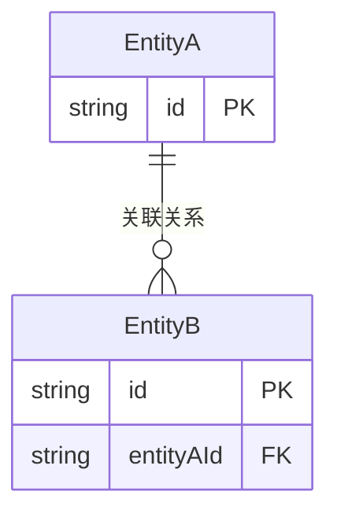

# [MODULE_NAME] Web 前端数据模型

## 1. 文档概述

本文档描述 [MODULE_NAME] 模块的前端数据结构设计，包括核心实体的 TypeScript 类型定义、数据关系和状态管理结构。

---

## 2. 核心实体

### 2.1 [EntityName]

[实体描述]

```typescript
interface EntityName {
  id: string              // 唯一标识
  // [根据实际需求定义字段]
  createdAt: string       // 创建时间 (ISO 8601)
  updatedAt: string       // 更新时间 (ISO 8601)
}
```

**字段说明**：

| 字段 | 类型 | 必填 | 说明 |
| :--- | :--- | :--- | :--- |
| id | string | 是 | 唯一标识符 |

**验证规则**：
- [字段验证规则]

---

### 2.2 [EntityName2]

[实体描述]

```typescript
interface EntityName2 {
  // [根据实际需求定义字段]
}
```

---

## 3. 数据关系

### 3.1 实体关系图



---

## 4. 请求/响应类型

### 4.1 [接口名称] 请求

```typescript
interface XXXRequest {
  // 请求参数
}
```

### 4.2 [接口名称] 响应

```typescript
interface XXXResponse {
  code: number
  message: string
  data: {
    // 响应数据
  }
}
```

---

## 5. 本地状态类型

```typescript
interface ModuleState {
  // UI 状态
  isLoading: boolean
  error: string | null
  // 业务数据
  // [根据实际需求定义]
}
```
