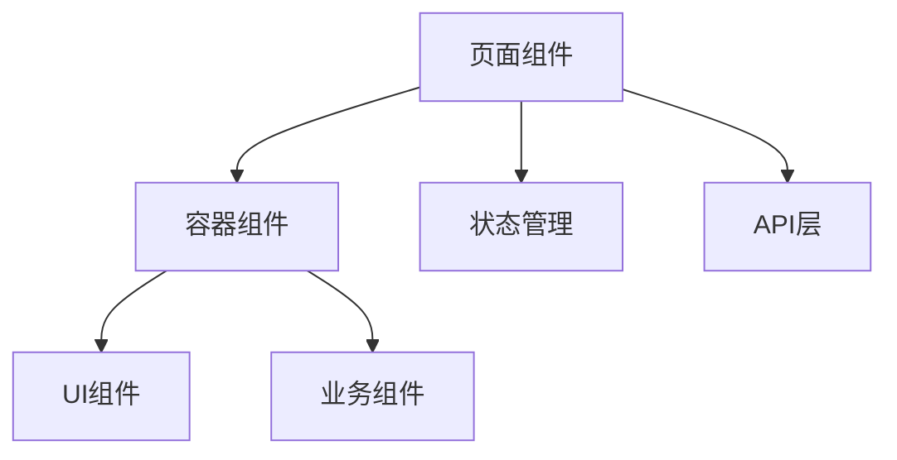
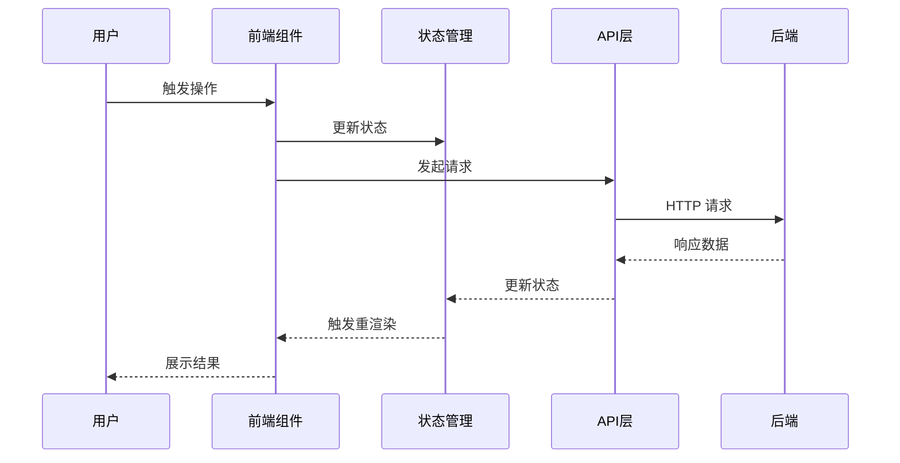
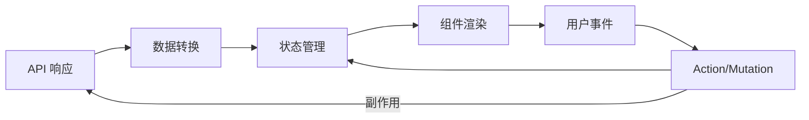
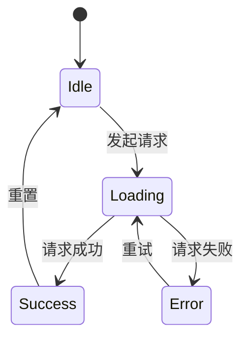

# [MODULE_NAME] Web 前端技术设计

## 0. 文档信息

| 属性 | 内容 |
| :--- | :--- |
| **所属变更** | [CHANGE_ID] |
| **模块名称** | [MODULE_NAME] |
| **模块类型** | web-frontend |
| **创建时间** | [CREATED_AT] |

---

## 1. 背景与目标

* **技术背景**：[当前技术现状及要解决的技术问题]
* **技术目标**：[本次技术设计要达成的目标]

---

## 2. 模块职责边界

**负责：**
- [如：用户设置页面的 UI 渲染和交互逻辑]
- [如：表单校验和状态管理]

**不负责（显式排除）：**
- [如：服务整体架构、路由方案（→ hld）]
- [如：后端 API 逻辑和数据库（→ web-backend）]

**调用关系：**

| 方向 | 模块 | 方式 |
| :--- | :--- | :--- |
| 被调用 | [如：路由层 / 导航] | 路由跳转 |
| 调用 | [如：后端 API] | HTTP 请求 |
| 调用 | [如：其他前端模块] | 组件引用 / 事件通信 |

---

## 3. 技术选型

| 技术领域 | 选择方案 | 备选方案 | 选择理由 |
| :--- | :--- | :--- | :--- |
| [领域] | [方案] | [备选] | [理由] |

---

## 4. 界面设计

> 在进入技术架构之前，先确定用户看到什么、怎么操作。
> 本节提供**布局结构 + 核心页面描述 + 交互行为**，作为组件拆分和状态管理的设计依据。

### 4.1 整体布局结构

<!--
  用 ASCII 线框图描述页面的基础布局骨架。
  目标：让实现者一眼理解页面分区和层次关系。
-->

```
┌─────────────────────────────────────────────┐
│ [导航栏 / Header]                            │
├──────────┬──────────────────────────────────┤
│          │                                   │
│ [侧边栏]  │      [主内容区]                    │
│          │                                   │
│          │                                   │
├──────────┴──────────────────────────────────┤
│ [底部栏 / Footer]（如有）                     │
└─────────────────────────────────────────────┘
```

**布局说明**：
- [描述布局类型：侧边栏导航 / 顶部导航 / 全屏沉浸 / 响应式断点等]
- [描述核心区域的功能定位]

### 4.2 核心页面与功能区

<!--
  对每个核心页面/视图，描述其内容结构和功能。
  每个页面用 ASCII 线框图 + 功能说明。
-->

#### 页面：[页面名称]

```
┌─────────────────────────────────────┐
│ [页面标题 / 面包屑]                   │
├─────────────────────────────────────┤
│                                      │
│  [功能区域 A]                         │
│  ┌──────────────────────────┐       │
│  │ [内容描述]                │       │
│  └──────────────────────────┘       │
│                                      │
│  [功能区域 B]                         │
│  ┌──────────────────────────┐       │
│  │ [内容描述]                │       │
│  └──────────────────────────┘       │
│                                      │
│  [操作区：按钮 / 表单 / 交互元素]      │
│                                      │
└─────────────────────────────────────┘
```

**功能说明**：
| 区域 | 内容 | 交互行为 |
| :--- | :--- | :--- |
| [区域名] | [展示什么] | [点击/输入后发生什么] |

<!-- 多个核心页面重复上述结构 -->

### 4.3 关键交互设计

| 交互场景 | 触发方式 | 反馈/效果 | 说明 |
| :--- | :--- | :--- | :--- |
| [如：提交表单] | [按钮点击] | [loading → 成功提示 / 错误提示] | [补充说明] |
| [如：列表筛选] | [下拉选择 / 输入搜索] | [实时过滤 / 防抖请求] | |
| [如：数据加载] | [页面进入 / 滚动触底] | [骨架屏 → 内容 / 加载更多] | |

### 4.4 响应式与适配

| 断点 | 布局变化 |
| :--- | :--- |
| 桌面（≥1024px） | [默认布局] |
| 平板（768–1023px） | [侧边栏折叠 / 布局调整] |
| 手机（<768px） | [单列 / 底部导航 / 特定适配] |

<!-- 如项目不需要响应式，注明"仅桌面端"并删除本表 -->

---

## 5. 架构概述

### 5.1 组件结构



### 5.2 目录结构

```
src/
├── pages/          # 页面组件
├── components/     # 可复用组件
├── hooks/          # 自定义 Hooks
├── services/       # API 调用层
├── stores/         # 状态管理
├── types/          # TypeScript 类型定义
└── utils/          # 工具函数
```

---

## 6. 关键流程设计

### DS-NNN [核心流程名称]
fr: FR-NNN
depends: DS-NNN, DS-NNN@other-module



---

## 7. 数据流转

### 7.1 页面数据流



### 7.2 核心数据流转说明

| 数据 | 来源 | 流向 | 转换逻辑 |
| :--- | :--- | :--- | :--- |
| [数据名] | [API / 本地] | [Store → 组件] | [映射/过滤/聚合] |

---

## 8. 状态管理设计

### 8.1 状态结构

```typescript
interface ModuleState {
  // [根据实际需求定义]
}
```

### 8.2 状态流转



[描述关键状态的变更时机和规则]

---

## 9. 错误处理与降级策略

| 错误场景 | 处理方式 | 降级方案 |
| :--- | :--- | :--- |
| 网络请求失败 | [处理方式] | [降级方案] |
| 数据格式异常 | [处理方式] | [降级方案] |

---

## 10. 性能设计

* **首屏加载**：[优化策略，如懒加载、代码分割]
* **渲染优化**：[避免不必要的重渲染策略]
* **缓存策略**：[本地缓存、请求缓存等]

---

## 11. i18n 与 a11y（适用时填）

> 产品要求多语言或可访问性标准时填写。

### 11.1 国际化

| 项 | 方案 |
| :--- | :--- |
| 语言检测 | [Accept-Language Header / 用户配置 / URL 前缀] |
| 翻译存储 | [JSON 文件 / 数据库 / i18next] |
| 模板支持 | [如：`t('key.name')` 翻译函数] |

---

## 12. 测试矩阵

| 测试目标 | 测试类型 | 通过条件 |
| :--- | :--- | :--- |
| 组件渲染 | 单元测试 | 关键组件正确渲染，无运行时错误 |
| 用户交互 | 集成测试 | 表单提交、按钮点击等交互行为符合预期 |
| API 对接 | 集成测试（Mock） | 请求参数正确，响应数据正确映射到 UI |
| 错误处理 | 单元测试 | API 失败时显示友好提示，不白屏 |
| 响应式 | 手动 / 快照测试 | 移动端和桌面端布局符合预期 |

---

## 13. 设计决策记录

<!--
  记录详细设计阶段方案探索环节做出的关键决策。
  每个决策应包含：问题、候选方案、最终选择和理由。
-->

### 决策 1：[决策标题]

* **问题**：[需要做决策的具体问题]
* **候选方案**：
  * A — [方案描述]：[优点] / [缺点]
  * B — [方案描述]：[优点] / [缺点]
* **决策**：选择方案 [X]
* **理由**：[为什么选择这个方案]
