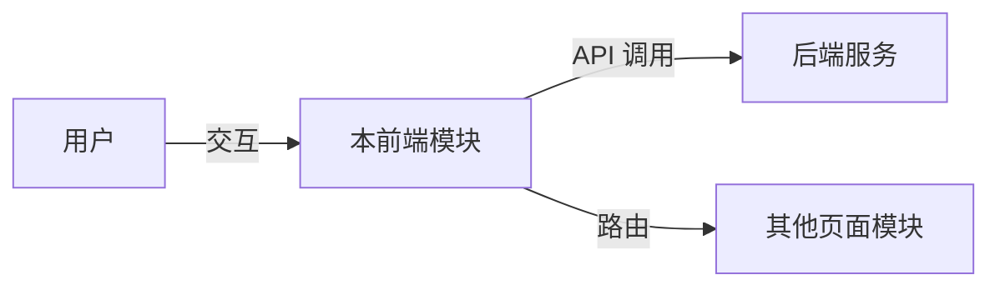
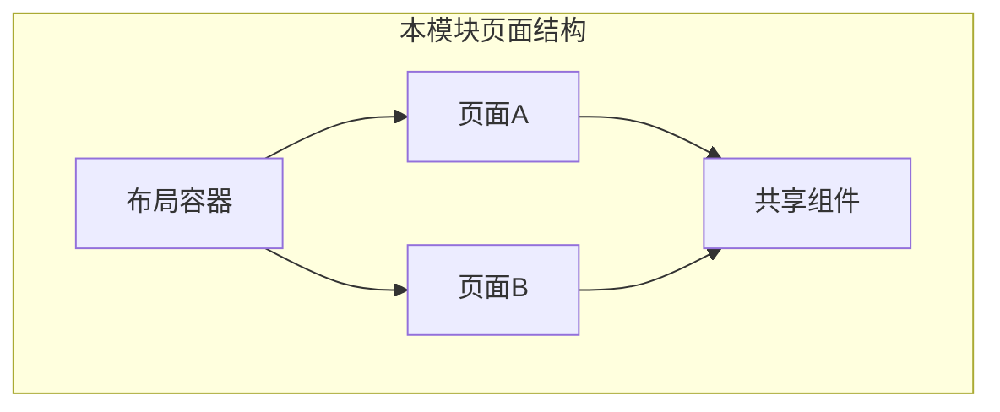
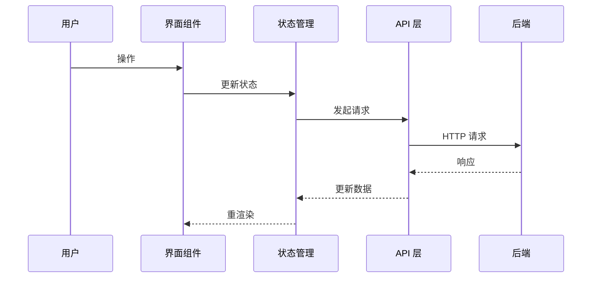

# [MODULE_NAME] Web 前端概要设计

## 0. 文档信息

| 属性 | 内容 |
| :--- | :--- |
| **所属变更** | [CHANGE_ID] |
| **模块名称** | [MODULE_NAME] |
| **模块类型** | web-frontend |
| **创建时间** | [CREATED_AT] |

### 修订记录

| 版本号 | 修改日期 | 修改内容摘要 | 修改人 |
| :--- | :--- | :--- | :--- |
| v1.0 | [CREATED_AT] | 初稿创建 | [AUTHOR] |

---

## 1. 技术范围界定

### 1.1 起点与终点

| 维度 | 说明 |
| :--- | :--- |
| **起点** | [用户入口，例如：URL 路由、页面入口、导航入口] |
| **终点** | [用户完成目标的终态，例如：操作成功提示、页面跳转、数据展示] |
| **解决的问题** | [一句话说清楚这个模块在 UI/交互 层面解决什么问题] |

### 1.2 技术边界

- **上游**：[用户从哪里进入本模块]
- **下游**：[本模块调用哪些后端接口或依赖哪些其他前端模块]
- **不涉及**：[明确本模块不处理的部分]

---

## 2. 架构方向探索

<!-- 记录概要设计前的架构方向快速探索结果 -->

| 方向 | 核心思路 | 适合场景 | 风险 |
| :--- | :--- | :--- | :--- |
| [方向1] | [一句话描述] | [什么情况下选] | [主要风险] |
| [方向2] | [一句话描述] | [什么情况下选] | [主要风险] |

**选定方向**：[方向X]
**选择理由**：[为什么选这个方向，一句话]

---

## 3. 架构方案

### 3.1 页面结构

### 3.2 核心交互流程

### 3.3 路由规划

| 路由 | 页面 | 说明 |
| :--- | :--- | :--- |
| /path-a | 页面A | [说明] |
| /path-b | 页面B | [说明] |

---

## 4. 技术选型与约束

| 领域 | 选型 | 理由 |
| :--- | :--- | :--- |
| 框架 | [React / Vue / Angular / ...] | [选择理由] |
| 状态管理 | [Redux / Zustand / Pinia / ...] | [选择理由] |
| 样式方案 | [CSS Modules / Tailwind / Styled-components / ...] | [选择理由] |
| 构建工具 | [Vite / Webpack / Next.js / ...] | [选择理由] |
| UI 组件库 | [Ant Design / MUI / 自建 / ...] | [选择理由] |

### 宪章合规性

- [ ] 符合 `constitution.md` 的技术栈约束
- [ ] 符合浏览器兼容性要求
- [ ] 符合可访问性要求

---

## 5. 认证与会话

| 项 | 方案 |
| :--- | :--- |
| 认证方式 | [Token / Session Cookie / OAuth2] |
| 登录页 | [如：`/login`，登录后设置 Cookie / 存储 Token] |
| 会话管理 | [Cookie-based Session / JWT in localStorage / httpOnly Cookie] |
| 登出 | [清除 Cookie/Token，重定向到登录页] |
| Token 刷新 | [静默刷新 / 无状态] |

---

## 6. 安全设计

| 威胁 | 防御措施 |
| :--- | :--- |
| XSS | [框架自动转义；不使用 dangerouslySetInnerHTML / v-html 渲染用户输入] |
| CSRF | [SameSite Cookie + CSRF Token / 仅使用 Bearer Token] |
| 敏感数据存储 | [密钥不存 localStorage；Cookie 设置 Secure + HttpOnly + SameSite] |

---

## 7. 观测与运维

### 7.1 质量目标

| 指标 | 目标值 | 测试条件 |
| :--- | :---: | :--- |
| FCP（首次内容绘制） | ≤ [X] ms | [4G 移动端] |
| LCP（最大内容绘制） | ≤ [X] ms | [4G 移动端] |
| CLS（累积布局偏移） | ≤ [X] | [正常加载] |
| 可用性 | ≥ [X]% | [滚动 30 天] |

### 7.2 监控指标

| 指标 | 说明 |
| :--- | :--- |
| JS 错误率 | 运行时异常上报 |
| API 请求成功率 | 前端发起的请求成功 / 总请求 |
| 页面加载时间分位 | P50 / P90 / P99 |

### 7.3 错误追踪

| 维度 | 方案 |
| :--- | :--- |
| 错误上报 | [Sentry / LogRocket / 自建] |
| 日志脱敏 | [不在日志中输出用户输入内容和 Token] |
| Source Map | [仅上传到错误追踪平台，不暴露到生产] |

---

## 8. 失败模式与降级策略

| 失败场景 | 影响 | 降级策略 | 恢复方式 |
| :--- | :--- | :--- | :--- |
| 后端 API 不可用 | [数据无法加载] | [显示缓存数据 / 友好错误提示] | [API 恢复后自动重试] |
| JS 运行时错误 | [页面功能异常] | [Error Boundary 兜底，不白屏] | [刷新页面] |
| 静态资源加载失败 | [样式/脚本缺失] | [CDN 降级到备用源 / 基本 HTML] | [资源恢复后正常] |
| 会话过期 | [操作被拒] | [重定向到登录页，保留原操作意图] | [重新登录] |
| 网络断开 | [请求失败] | [显示离线提示，不丢失已填内容] | [网络恢复后自动重试] |

---

## 9. 待研究事项

<!-- 列出需要在详细设计前调研的技术不确定项，将由 research.md 跟踪 -->

| 编号 | 待研究问题 | 优先级 | 影响范围 |
| :--- | :--- | :--- | :--- |
| R-01 | [不确定的技术点] | 高 / 中 / 低 | [影响哪些设计决策] |
| R-02 | [不确定的技术点] | 高 / 中 / 低 | [影响哪些设计决策] |

---

## 10. 风险与对策

| 风险 | 概率 | 影响 | 对策 |
| :--- | :--- | :--- | :--- |
| [风险描述] | 高/中/低 | 高/中/低 | [应对策略] |

---

## 11. 概要设计确认

- [ ] 技术范围已界定
- [ ] 架构方向已探索并选定
- [ ] 架构方案已确认
- [ ] 技术选型符合宪章
- [ ] 待研究事项已识别

👉 确认后进入详细设计阶段（`/xf:detail`）
